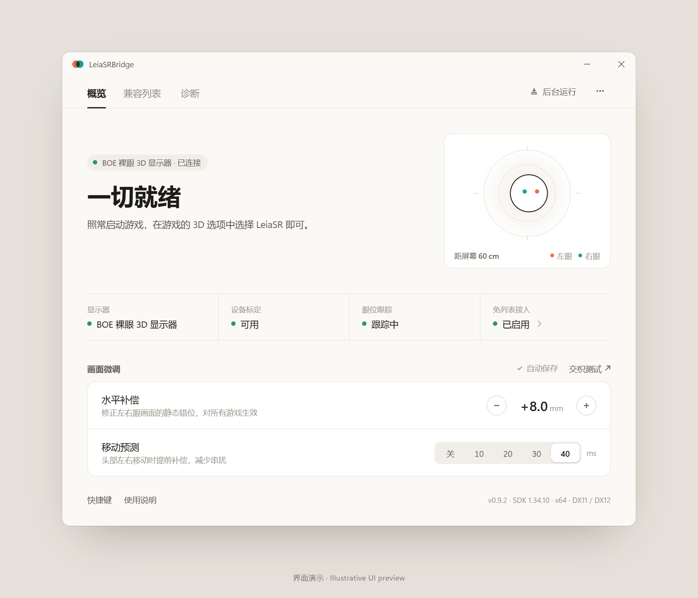
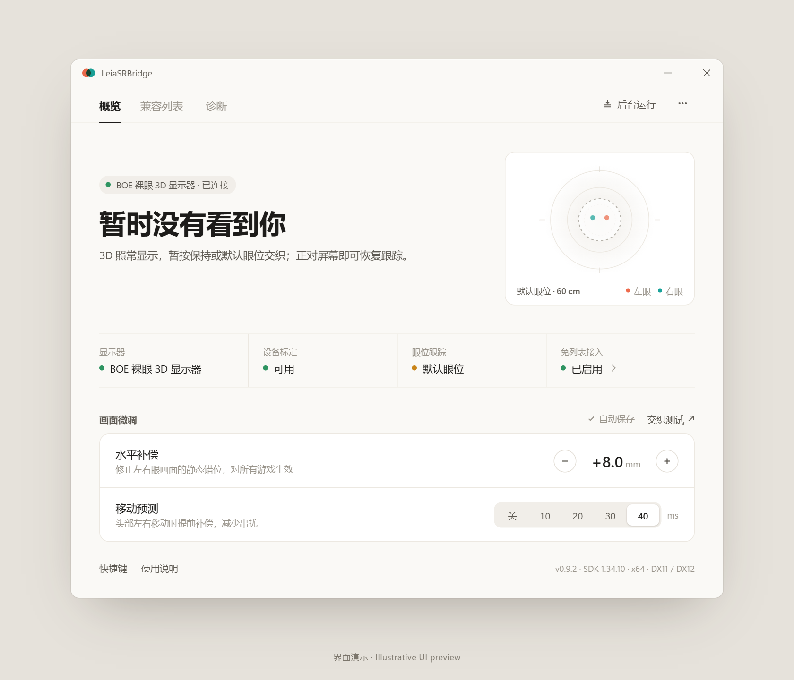
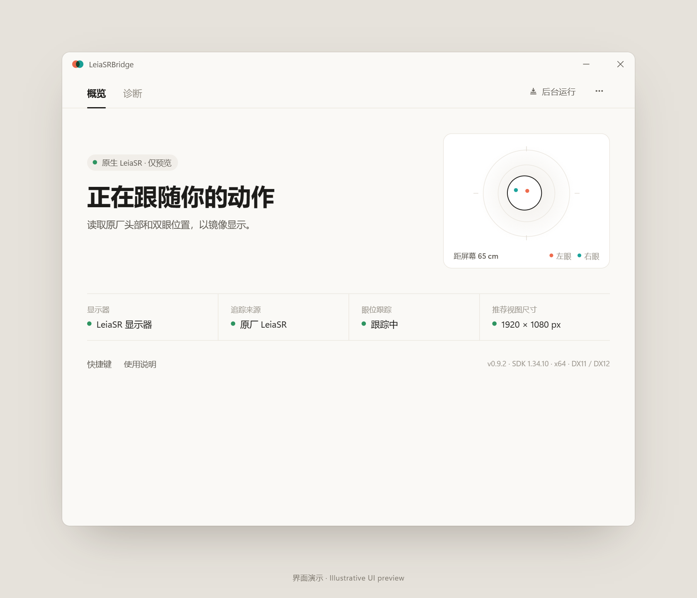

# LeiaSRBridge

将**泰坦军团、雷神、AOC 的裸眼 3D 显示器接入 LeiaSR 运行时**，并兼容 Odyssey 3D Hub。也可能兼容其他使用 DepthTransformerPlus 的裸眼 3D 显示器。

Connect **Titan Army, Thunderobot and AOC glasses-free 3D displays to the LeiaSR runtime**, with compatibility for Odyssey 3D Hub. Other glasses-free 3D displays using DepthTransformerPlus may also be compatible.

[下载 / Download](https://github.com/PureDark/LeiaSRBridge/releases/latest) · [中文](#中文) · [English](#english)

使用正式界面和演示数据生成的预览，保留设计稿留白。并非实机验证记录。 / Production UI rendered with illustrative data and design-style spacing; not a hardware validation capture.

## 中文

### 功能

- **LeiaSR 接入**：面向 SDK 1.34.10、Windows x64，支持 DX12 及 Odyssey 使用的旧版 DX11/DX12 路径。
- **后台运行**：一次启用免列表接入后，适用客户端可照常从 Steam 或快捷方式启动；支持开机自启动、托盘运行及可选游戏列表。
- **眼位与头部追踪**：提供双眼位置、头部位置与旋转，镜像预览实时姿态。暂时丢失人脸时使用保持或默认眼位，继续输出 3D。
- **全局画面调节**：水平眼位补偿、移动预测与快捷键对桥接客户端统一生效，自动保存，不修改 MCU 标定。
- **原生 LeiaSR 预览**：真实 LeiaSR 显示器可读取原厂追踪和推荐单眼尺寸，仅预览，不启动 BOE 桥接。
- **更新与诊断**：内置 GitHub Release 检查、下载、校验、安装及重启；另有独立交织测试、设备状态和日志。提供 Odyssey 3D Hub 兼容启动入口，具体游戏效果仍需验证。

### 兼容设备

| 显示器 | 当前状态 |
|---|---|
| 泰坦军团 M27E6V-3D | 已实机验证 |
| 雷神、AOC 的已分析 BOE / DepthTransformerPlus 方案 | 软件层面兼容，实体屏待验证 |
| 其他采用相同底层方案的显示器 | 需确认具体型号和组件 |
| ViewX | 暂不支持 |

兼容性取决于设备控制、眼追与交织组件，**仅使用 BOE 面板不代表兼容**。详见[兼容性分析与完整说明](README.zh-CN.md#显示器兼容性)。

### 快速开始

1. 下载 Release 中的 **win64 完整 ZIP**，解压到可写目录。连接显示器的视频线和 USB，将目标裸眼屏设为主显示器。
2. 退出 DepthTransformerPlus 等占用摄像头或设备的程序，运行 `LeiaSRBridge.exe`。完整包可独立运行，无需安装 DepthTransformerPlus。
3. 首次点击“启用免列表接入”并完成管理员授权，然后完全退出并重开 Steam 等启动器。
4. 等待设备和标定就绪，点击“后台运行”，在游戏或 Mod 中选择 **LeiaSR**。

无需逐个添加使用常规 SDK 加载方式的游戏；自带运行库或自定义加载方式的客户端可能需要游戏列表。界面需要 Microsoft Edge WebView2 Runtime。

**升级：**“更多 → 检查更新 → 下载更新”，退出游戏、交织测试和 Hub 后选择“安装并重启”。保留设置、游戏列表和标定，覆盖失败会尝试回滚。0.9.1 及更早版本须先手动安装一次 0.9.2 或更新版本。更新检查匿名访问 GitHub；私有仓库期间会显示访问失败信息。

[完整使用说明](README.zh-CN.md) · [Odyssey 使用步骤](docs/ODYSSEY.zh-CN.md) · [构建与打包](docs/BUILD.zh-CN.md)

## English

### Features

- **LeiaSR compatibility:** targets SDK 1.34.10 on Windows x64, with DX12 and the legacy DX11/DX12 paths used by Odyssey.
- **Background operation:** configure system integration once, then launch compatible games normally through Steam or shortcuts. Includes startup at sign-in, a system tray, and an optional game list.
- **Eye and head tracking:** exposes both eye positions, head position and rotation, with a mirrored preview. Temporary tracking loss uses held or default eye positions to keep 3D output available.
- **Global tuning:** horizontal eye-position offset, motion prediction and hotkeys apply across bridge clients. Settings are saved without changing the display's MCU calibration.
- **Native LeiaSR preview:** reads vendor tracking and recommended per-eye dimensions on genuine LeiaSR displays, without starting the BOE bridge.
- **Updates and diagnostics:** check, download, verify and install GitHub Releases, then restart. Includes a standalone interlacing test, device status and logs. An Odyssey 3D Hub compatibility launcher is available; individual games still require validation.

### Display compatibility

| Display | Status |
|---|---|
| Titan Army M27E6V-3D | Tested on hardware |
| Analyzed Thunderobot and AOC BOE / DepthTransformerPlus packages | Software-compatible; hardware validation pending |
| Other displays using the same underlying stack | Model and component verification required |
| ViewX | Not supported yet |

Compatibility depends on device control, eye tracking and interlacing components. **A BOE panel alone does not establish compatibility.**

### Getting started

1. Download the **win64 ZIP** from Releases and extract it to a writable folder. Connect both video and USB, and set the target 3D display as the primary monitor.
2. Close DepthTransformerPlus and other apps using the camera or device, then run `LeiaSRBridge.exe`. The complete package does not require DepthTransformerPlus to be installed.
3. Enable system integration (“启用免列表接入”) once and accept the administrator prompt. Fully restart Steam or other game launchers.
4. Wait for the device and calibration to become ready, leave the bridge running in the background, and select **LeiaSR** in the game or mod.

Clients using standard SDK loading need no per-game registration. Bundled runtimes or custom loaders may require the optional game list. Microsoft Edge WebView2 Runtime is required for the UI, which is currently in Chinese.

**Updating:** open More → Check for updates (“更多 → 检查更新”), download the update, close games, the interlacing test and Hub, then install and restart. Settings, game profiles and calibration are preserved; failed replacements attempt rollback. Version 0.9.1 and earlier need one manual upgrade to 0.9.2 or later. Update checks are anonymous, so a private repository produces an access error.

[Detailed guide (Chinese)](README.zh-CN.md) · [Odyssey guide (Chinese)](docs/ODYSSEY.zh-CN.md) · [Build instructions (Chinese)](docs/BUILD.zh-CN.md)

## 更多界面 / More previews

| 默认眼位回退 / Default-eye fallback | 原生 LeiaSR 预览 / Native LeiaSR preview |
|---|---|
|  |  |

演示状态，点击图片查看大图。 / Illustrative states; click an image to view it at full size.
